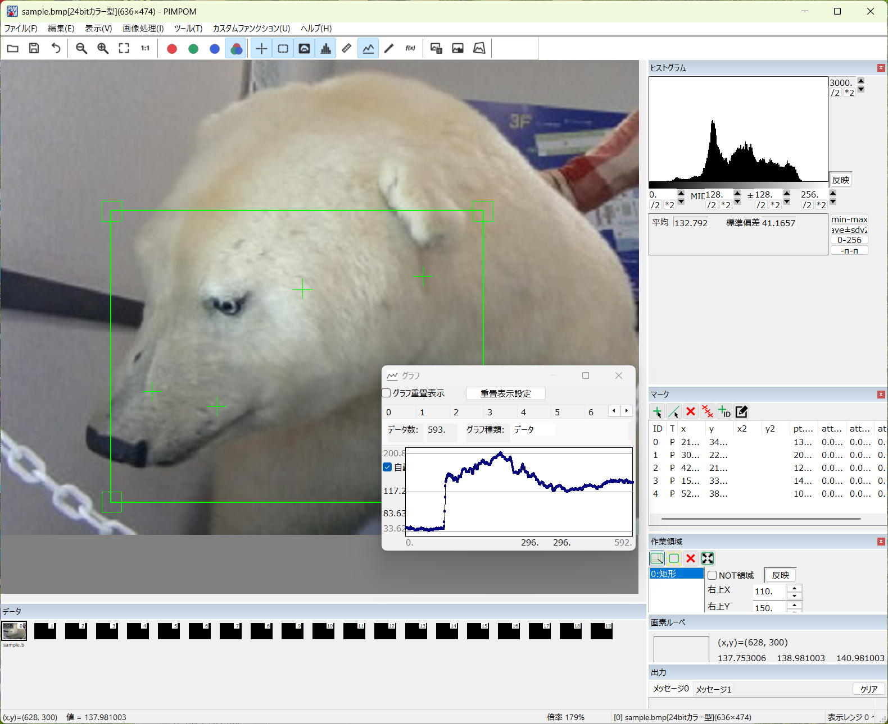

## PIMPOM
PIMPOM is a rapid prototyping tool for image processing (version 1.7.0.0).

**features**

- Main window with a toolbar and dockable panes (data, histogram, mark, work area, pixel loupe, output).
- Displays and edits many kinds of image data: 8/16/32-bit integer, float, complex, RGB, 3D (multi-page) and XYZ (3D shape), each with a mask.
- Marks, work areas, rulers and line profiles on the image, with graphs and histograms.
- Image processing such as filters, resizing, geometric transform, binarization and image generation from expressions.
- Script and batch execution, Python scripts, TCP/IP communication and video capture.
- Custom functions (your own C++ DLLs) and data exchange with external programs and Python.

**developing environment**

- All source code is written in C++.
- Visual Studio 2022 is used for building (`PIMPOM2022.sln`, x64). The build output goes to `bin\x64\Release` or `bin\x64\Debug`.
- MFC is used for the HMI.
- OpenCV 4.4.0 is used internally. Boost.Python is used only for the Python extension module `Pimpom.pyd` (`Tool\PimpomPlotPy`).
- The HMI, documents and comments in the source code are written in Japanese only.

**requirements**

- Windows 10 or later (64-bit).
- Install Python 3.8 or later on your computer to use the "Python script" function.
  - *https://www.python.org/downloads/*
  - `python\Pimpom.py` also needs pywin32 and numpy.
- The debug build extracts the following file automatically on its first build (needs Windows 10 1803 or later for tar.exe).
  - *OpenCV\x64\vc14bin\Debug.zip*

**documents**

- Software specification (HTML): *Doc\html\index.html*
- Manuals (Word): API reference for custom functions, script manual, data exchange with external programs and with Python, in *Doc*
- These can also be opened from the Help menu of PIMPOM.

------------------------------------------------------------
BSD 3-Clause License

Copyright (c) 2026, yasuyuki-ikeda
All rights reserved.

Redistribution and use in source and binary forms, with or without
modification, are permitted provided that the following conditions are met:

1. Redistributions of source code must retain the above copyright notice, this
   list of conditions and the following disclaimer.

2. Redistributions in binary form must reproduce the above copyright notice,
   this list of conditions and the following disclaimer in the documentation
   and/or other materials provided with the distribution.

3. Neither the name of the copyright holder nor the names of its
   contributors may be used to endorse or promote products derived from
   this software without specific prior written permission.

THIS SOFTWARE IS PROVIDED BY THE COPYRIGHT HOLDERS AND CONTRIBUTORS "AS IS"
AND ANY EXPRESS OR IMPLIED WARRANTIES, INCLUDING, BUT NOT LIMITED TO, THE
IMPLIED WARRANTIES OF MERCHANTABILITY AND FITNESS FOR A PARTICULAR PURPOSE ARE
DISCLAIMED. IN NO EVENT SHALL THE COPYRIGHT HOLDER OR CONTRIBUTORS BE LIABLE
FOR ANY DIRECT, INDIRECT, INCIDENTAL, SPECIAL, EXEMPLARY, OR CONSEQUENTIAL
DAMAGES (INCLUDING, BUT NOT LIMITED TO, PROCUREMENT OF SUBSTITUTE GOODS OR
SERVICES; LOSS OF USE, DATA, OR PROFITS; OR BUSINESS INTERRUPTION) HOWEVER
CAUSED AND ON ANY THEORY OF LIABILITY, WHETHER IN CONTRACT, STRICT LIABILITY,
OR TORT (INCLUDING NEGLIGENCE OR OTHERWISE) ARISING IN ANY WAY OUT OF THE USE
OF THIS SOFTWARE, EVEN IF ADVISED OF THE POSSIBILITY OF SUCH DAMAGE.
